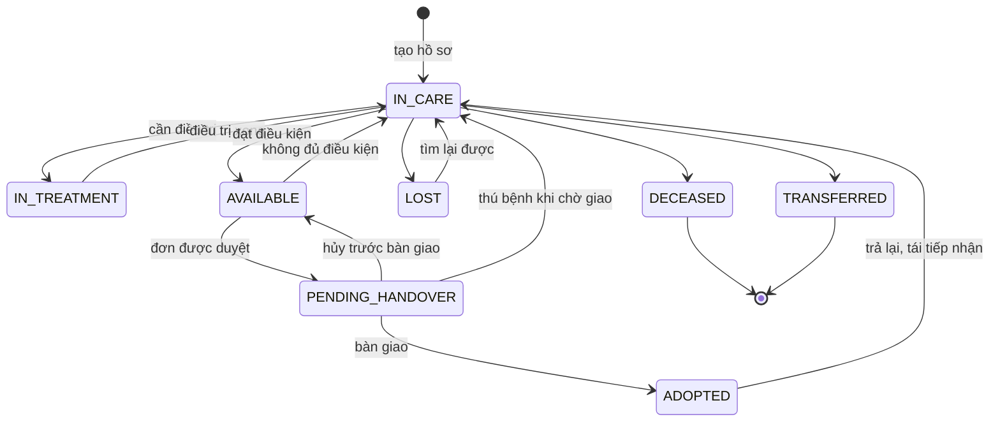
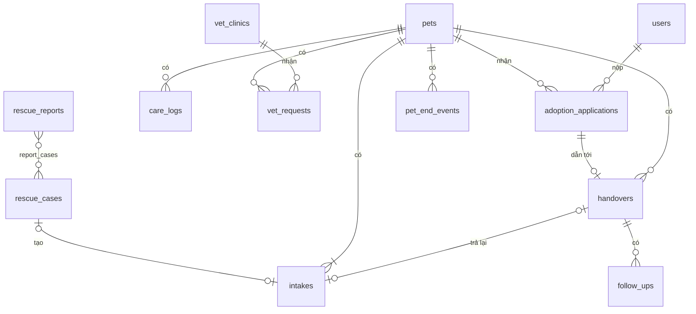

# Báo cáo đồ án: Hệ thống quản lý cứu hộ thú cưng và nhận nuôi

# Chương 1. Tổng quan đề tài

## 1.1. Giới thiệu và lý do chọn đề tài

## 1.2. Khảo sát hiện trạng và vấn đề tồn tại

## 1.3. Khảo sát hệ thống và nghiên cứu liên quan

## 1.4. Mục tiêu và phạm vi hệ thống

- Mục tiêu: quản lý xuyên suốt vòng đời thú cưng, từ cứu hộ đến hậu kiểm và tái tiếp nhận.
- Hệ thống phục vụ một trung tâm cứu hộ duy nhất, quản lý hai loài chó và mèo. Phạm vi gồm 4 nhóm nghiệp vụ (Cứu hộ, Chăm sóc và phối hợp thú y, Nhận nuôi, Bàn giao - hậu kiểm - trả lại) và 2 nhóm hỗ trợ (Báo cáo thống kê, Tài khoản và phân quyền).
- Cơ sở thú y là thực thể ngoài: hệ thống chỉ ghi nhận yêu cầu, kết quả và tổng chi phí điều trị, không quản lý hoạt động nội bộ của phòng khám.
- Ngoài phạm vi: mô hình nhiều trung tâm hoặc chi nhánh, các loài khác ngoài chó và mèo, gửi thông báo email/SMS, thu phí nhận nuôi và xử lý thanh toán, xử lý pháp lý khi chủ nuôi không trả thú, quản lý chuồng trại chi tiết, kho thức ăn và thuốc, lịch khám và đơn thuốc chi tiết, thanh toán với phòng khám, tài khoản cho phòng khám, tích hợp API, quản lý quyên góp (chỉ ghi nhận khoản ủng hộ tự nguyện khi bàn giao).

## 1.5. Các đối tượng sử dụng hệ thống

- Khách: người dân không đăng nhập (báo cứu hộ, tra cứu báo cáo, xem thú sẵn sàng).
- Người nhận nuôi: có tài khoản, kế thừa quyền của Khách.
- Nhân viên trung tâm.
- Quản lý trung tâm: kế thừa quyền của Nhân viên, thêm phân công ca cứu hộ, báo cáo và quản trị hệ thống.

# Chương 2. Phân tích yêu cầu hệ thống

## 2.1. Mô tả quy trình nghiệp vụ

Mỗi con thú (chó hoặc mèo) đi qua 4 quy trình: cứu hộ, chăm sóc và thú y, nhận nuôi, bàn giao và hậu kiểm. Khi không đủ điều kiện nhận nuôi hoặc bị trả lại, thú quay về chăm sóc. Qua đời, thất lạc và chuyển cơ sở có thể kết thúc vòng đời ở bất kỳ giai đoạn nào.

### 2.1.1. Tổng quan

> Sơ đồ này xem ở bản báo cáo online: https://claude.ai/artifact/UESS64WHDvFkrjWkQciXVM

Cơ sở thú y là thực thể ngoài (external entity), nằm ngoài ranh giới hệ thống: trung tâm gửi yêu cầu và nhận lại kết quả, chi phí. Hai vòng lặp quay về chăm sóc là phần nghiệp vụ cần chú ý nhất.



Đang chăm sóc (IN_CARE) có thể vào trạng thái kết thúc từ mọi trạng thái hoạt động; sơ đồ chỉ vẽ một nhánh cho gọn. Bảng đầy đủ ở mục 3.4.

Đang chăm sóc là trạng thái trung tâm: mọi nhánh lùi (không đủ điều kiện, trả lại) đều quay về đây. Đây là bản phác cho mục 3.4.

**Trạng thái Thú cưng**

| Trạng thái | Ý nghĩa | Vào trạng thái khi |
| --- | --- | --- |
| Đang chăm sóc | Thú ở trung tâm (khu cách ly hoặc khu chung), chưa đủ điều kiện nhận nuôi | Có lượt tiếp nhận mới (cứu hộ, trả lại, tìm lại sau thất lạc), điều trị xong, hoặc không đủ điều kiện (khi Sẵn sàng hoặc Chờ bàn giao) |
| Đang điều trị | Có yêu cầu thú y đang mở. Thú ở trung tâm (ngoại trú) hoặc tại phòng khám (lưu trú) | Mở yêu cầu thú y. Về Đang chăm sóc khi yêu cầu cuối cùng đóng |
| Sẵn sàng nhận nuôi | Hiển thị cho người dân đăng ký | Đạt đủ checklist điều kiện (2.1.3) |
| Chờ bàn giao | Đã có đơn được duyệt, chưa giao | Một đơn được duyệt |
| Đã nhận nuôi | Đã giao cho chủ nuôi, đang hoặc đã hậu kiểm | Bàn giao thành công |
| Qua đời / Thất lạc / Đã chuyển cơ sở | Trạng thái kết thúc, chỉ còn lịch sử (thú thất lạc tìm lại được thì tiếp nhận lại) | Xem 2.1.6 |

**Trạng thái Đơn nhận nuôi:** Chờ xét duyệt => Đã duyệt => Đã bàn giao. Nhánh kết thúc: Từ chối, Đã hủy (người nhận nuôi hủy trước hoặc sau khi được duyệt, hoặc hệ thống tự đóng khi thú đã có đơn khác được duyệt, qua đời, thất lạc hay không đủ điều kiện).

**Lượt tiếp nhận:** mỗi lần thú vào trung tâm tạo một lượt tiếp nhận (ngày, nguồn: cứu hộ / trả lại / tìm lại sau thất lạc, lý do, khu vực, đánh giá ban đầu). Hồ sơ thú là duy nhất và có nhiều lượt. Ca cứu hộ chỉ là ticket, đóng khi xong. Thú bị cứu lại sau khi đã rời trung tâm được tạo hồ sơ mới, vì hệ thống không nhận diện thú cũ.

### 2.1.2. Tiếp nhận và xử lý cứu hộ

| Thành phần | Nội dung |
| --- | --- |
| Mục tiêu | Biến một báo cáo của người dân thành hồ sơ thú trong trung tâm |
| Tác nhân | Khách (không cần tài khoản, để lại tên và số điện thoại), Nhân viên |
| Kích hoạt | Người dân gửi báo cáo (vị trí, mô tả, ảnh) |
| Bước chính | 1. Nhân viên tiếp nhận báo cáo => 2. Tạo ca cứu hộ, Quản lý phân công người đi cứu => 3. Đi cứu => 4. Cứu thành công: tạo hồ sơ thú (loài) và lượt tiếp nhận (nguồn cứu hộ, khu cách ly, đánh giá ban đầu), đóng ca |
| Ngoại lệ | Báo cáo trùng: gộp vào ca đã có. Báo cáo có nhiều thú: tách thành nhiều ca. Cứu hộ thất bại: đóng ca, ghi lý do, không tạo hồ sơ. Báo cáo sai hoặc spam: đánh dấu Không hợp lệ |
| Dữ liệu | Báo cáo cứu hộ, Ca cứu hộ, Thú cưng, Lượt tiếp nhận |
| Trạng thái | Báo cáo: Mới => Đã xử lý / Trùng / Không hợp lệ. Ca: Mới => Đang xử lý => Thành công / Thất bại. Thú: tạo mới ở Đang chăm sóc |

### 2.1.3. Chăm sóc và phối hợp thú y

| Thành phần | Nội dung |
| --- | --- |
| Mục tiêu | Đưa thú về trạng thái đủ điều kiện nhận nuôi và lưu đầy đủ lịch sử sức khỏe |
| Tác nhân | Nhân viên. Cơ sở thú y là bên ngoài: nhân viên nhập hộ kết quả |
| Kích hoạt | Có lượt tiếp nhận mới |
| Bước chính | 1. Tạo yêu cầu thú y theo mức ưu tiên ban đầu (mọi thú khám ít nhất một lần) => 2. Chăm sóc thường ngày, khi cần bác sĩ thì tạo thêm yêu cầu điều trị => 3. Ghi nhận kết quả, tổng chi phí, hướng dẫn sau điều trị, chăm sóc theo hướng dẫn => 4. Đánh giá điều kiện nhận nuôi theo checklist |
| Ngoại lệ | Thú không đủ điều kiện khi đang Sẵn sàng (bệnh tái phát…): quay về Đang chăm sóc. Thú không đủ điều kiện khi đang Chờ bàn giao: về Đang chăm sóc, đơn đã duyệt bị hủy, báo cho người nhận. Thú qua đời trong điều trị: xem 2.1.6 |
| Dữ liệu | Nhật ký chăm sóc, Yêu cầu thú y (hình thức, kết quả, chi phí, hướng dẫn sau điều trị), Cơ sở thú y |
| Trạng thái | Thú: Đang chăm sóc <=> Đang điều trị (mở yêu cầu thì vào, đóng yêu cầu cuối cùng thì ra) => Sẵn sàng nhận nuôi. Yêu cầu: Chờ xử lý => Đang điều trị => Hoàn tất / Hủy |

Quy ước: chăm sóc là việc nhân viên tự làm, còn mọi việc cần bác sĩ (kể cả tiêm phòng, triệt sản) đều đi qua Yêu cầu thú y.

**Thú ở trung tâm trước và sau thú y**

- Khu vực: thú mới về ở khu cách ly trong thời gian theo dõi, sau đó chuyển sang khu chung. Hồ sơ chỉ lưu khu vực hiện tại, không quản lý chuồng trại.
- Trong điều trị: yêu cầu thú y ghi hình thức Ngoại trú (khám xong về trung tâm) hoặc Lưu trú (ở lại phòng khám). Hồ sơ thú cập nhật nơi ở hiện tại.
- Sau điều trị: kết quả kèm hướng dẫn chăm sóc (thuốc, lịch tái khám). Nhân viên ghi nhật ký theo hướng dẫn. Tái khám là một yêu cầu thú y mới.
- Nhật ký chăm sóc: ngày, nhân viên, loại hoạt động (cho ăn, vệ sinh, cân nặng, dùng thuốc, ghi chú sức khỏe), ghi chú.

**Đánh giá ban đầu** (nhân viên làm ở mỗi lượt tiếp nhận)

| Mức ưu tiên | Dấu hiệu | Xử lý |
| --- | --- | --- |
| Khẩn cấp | Chấn thương, chảy máu, bất tỉnh, bỏ ăn uống | Tạo yêu cầu thú y ngay |
| Cần khám | Dấu hiệu bệnh, gầy yếu, ve rận nặng | Tạo yêu cầu thú y trong vài ngày |
| Ổn định | Không có dấu hiệu bất thường | Chăm sóc bình thường, xếp lịch khám tổng quát |

Mọi thú đều qua thú y ít nhất một lần (khám tổng quát, tiêm phòng) trước khi được Sẵn sàng. Đánh giá ban đầu chỉ quyết định độ ưu tiên.

**Checklist đủ điều kiện nhận nuôi** (đủ tất cả mới được chuyển sang Sẵn sàng)

1. Sức khỏe ổn định: không còn yêu cầu thú y đang mở, lần khám gần nhất kết luận ổn (nhân viên ghi kết luận sức khỏe khi hoàn tất yêu cầu thú y).
2. Đã tiêm phòng cơ bản theo loài (chó, mèo).
3. Đã tẩy giun, ký sinh trùng.
4. Đủ tuổi tách mẹ.
5. Đã triệt sản nếu đủ tuổi. Nếu chưa đủ tuổi thì đơn nhận nuôi phải kèm cam kết triệt sản.
6. Đã hết thời gian cách ly theo dõi sau tiếp nhận, tính cách không hung dữ.

Ngưỡng cụ thể (số tuần tuổi, số ngày theo dõi) lấy từ khảo sát thực tế.

### 2.1.4. Đăng ký và xét duyệt nhận nuôi

| Thành phần | Nội dung |
| --- | --- |
| Mục tiêu | Chọn được một người nhận nuôi phù hợp cho mỗi thú |
| Tác nhân | Người nhận nuôi (bắt buộc có tài khoản), Nhân viên |
| Kích hoạt | Người nhận nuôi chọn một thú đang Sẵn sàng và nộp đơn |
| Bước chính | 1. Nộp đơn => 2. Nhân viên thẩm định (thông tin, điều kiện nuôi) và duyệt hoặc từ chối => 3. Đơn duyệt: nhân viên ghi ngày hẹn bàn giao trên hệ thống (đổi được), người nhận nuôi thấy ngày hẹn trong mục Đơn của tôi |
| Ngoại lệ | Nhiều đơn cho cùng một thú: chỉ một đơn được duyệt, các đơn còn lại tự đóng. Người nhận nuôi hủy đơn. Thú không đủ điều kiện khi đơn đang chờ: đơn bị đóng |
| Dữ liệu | Đơn nhận nuôi (kèm cam kết triệt sản nếu thú chưa triệt sản, ngày hẹn bàn giao), Người dùng (số điện thoại, địa chỉ) |
| Trạng thái | Đơn: Chờ xét duyệt => Đã duyệt / Từ chối / Đã hủy. Đã duyệt => Đã bàn giao / Đã hủy. Thú: Sẵn sàng => Chờ bàn giao |

### 2.1.5. Bàn giao, hậu kiểm và trả lại

| Thành phần | Nội dung |
| --- | --- |
| Mục tiêu | Giao thú cho chủ nuôi và theo dõi đến khi ổn định |
| Tác nhân | Nhân viên, Người nhận nuôi có đơn đã duyệt (gọi là chủ nuôi sau khi bàn giao) |
| Kích hoạt | Đơn nhận nuôi được duyệt |
| Bước chính | 1. Bàn giao (hệ thống chỉ ghi nhận xác nhận bàn giao, không xuất biên bản), ghi khoản ủng hộ tự nguyện (nếu có) => 2. Lập 2 lần hậu kiểm (khoảng 2 tuần và 2 tháng sau bàn giao) => 3. Hậu kiểm theo 5 tiêu chí, ghi kết quả Đạt / Cần theo dõi / Không đạt (hai mức sau bắt buộc ghi lý do) => 4. Đạt cả 2 lần: kết thúc hậu kiểm |
| Ngoại lệ | Hủy trước bàn giao: thú về Sẵn sàng, các đơn đã đóng không mở lại, người dân nộp đơn mới nếu muốn. Chủ nuôi trả lại (bất kỳ lúc nào, kể cả sau hậu kiểm) hoặc hậu kiểm không đạt: tạo lượt tiếp nhận mới (nguồn trả lại), thú về Đang chăm sóc, lịch sử nhận nuôi cũ được giữ. Cần theo dõi: thêm một lần hậu kiểm bổ sung. Thú qua đời hoặc đi lạc trong thời gian hậu kiểm: ghi nhận Qua đời / Thất lạc, kết thúc hậu kiểm |
| Dữ liệu | Bàn giao (kèm khoản ủng hộ), Hậu kiểm, Đơn nhận nuôi, Lượt tiếp nhận (khi trả lại) |
| Trạng thái | Thú: Chờ bàn giao => Đã nhận nuôi (=> Đang chăm sóc nếu bị trả lại). Đơn: Đã duyệt => Đã bàn giao |

Sau khi hậu kiểm kết thúc, trung tâm ngừng chủ động theo dõi. Thú giữ trạng thái Đã nhận nuôi, nhưng chủ nuôi vẫn có thể trả lại bất kỳ lúc nào. Khi bàn giao, nhân viên cho người nhận xem 3 con số của thú: tổng chi phí điều trị (gồm cả chi phí phát sinh sau khi bị trả lại), đã được ủng hộ (cộng dồn qua các lần bàn giao), còn chưa bù đắp (tổng trừ đã ủng hộ, thấp nhất là 0). Người nhận có thể ủng hộ tùy tâm. Khoản ủng hộ không hoàn lại khi trả thú, phần vượt chi phí thuộc về trung tâm. Hệ thống chỉ ghi nhận số tiền, không xử lý thanh toán.

**Tiêu chí kết quả hậu kiểm**

Mỗi lần hậu kiểm, nhân viên đánh giá 5 tiêu chí cố định: sức khỏe thú, điều kiện chỗ ở, thực hiện cam kết (tiêm nhắc, triệt sản), thú còn ở với chủ nuôi, chủ nuôi liên lạc được. Lần 1 gọi điện, chủ nuôi gửi ảnh qua kênh ngoài (Zalo, email) và nhân viên đính kèm vào kết quả. Lần 2 thăm nhà hoặc gọi video. Hệ thống ghi hình thức liên hệ của từng lần (gọi điện, thăm nhà, gọi video). Kết quả chọn theo bảng sau.

| Kết quả | Khi nào | Ví dụ |
| --- | --- | --- |
| Đạt | Thú khỏe, được chăm sóc đúng cam kết, chủ nuôi hợp tác | Ăn uống tốt, chỗ ở phù hợp, đã tiêm nhắc theo lịch |
| Cần theo dõi | Có vấn đề nhỏ, khắc phục được | Thú chưa thích nghi, chậm tiêm nhắc, chỗ ở chưa phù hợp, lần đầu không liên lạc được |
| Không đạt | Vi phạm nghiêm trọng hoặc không cải thiện | Thú bị bỏ bê hoặc ngược đãi, chủ tự ý cho hoặc bán thú, quá hạn cam kết triệt sản, không liên lạc được sau lần hậu kiểm bổ sung, hoặc đã Cần theo dõi mà lần bổ sung vẫn không cải thiện |

Kết quả do nhân viên chọn theo bảng tiêu chí trên, hệ thống không tự suy ra. Hệ thống chỉ ghi nhận kết quả Không đạt. Khi thú thực sự về trung tâm, nhân viên tạo lượt tiếp nhận mới. Trường hợp chủ nuôi không chịu trả thú là vấn đề pháp lý, nằm ngoài phạm vi.

### 2.1.6. Sự kiện kết thúc vòng đời

Ba sự kiện này đưa thú vào trạng thái kết thúc. Hồ sơ và toàn bộ lịch sử được giữ nguyên, không xóa.

| Sự kiện | Xảy ra khi | Xử lý kèm theo |
| --- | --- | --- |
| Qua đời | Khi thú ở trung tâm hoặc trong thời gian hậu kiểm | Hủy yêu cầu thú y đang mở (hệ thống nhắc ghi kết quả và chi phí trước để không thiếu trong 3 con số chi phí), đóng các đơn đang chờ hoặc đã duyệt |
| Thất lạc | Thú trốn khỏi trung tâm, hoặc đi lạc trong thời gian hậu kiểm | Như trên, ghi ngày và nơi mất. Tìm lại được: tạo lượt tiếp nhận mới trên hồ sơ cũ |
| Chuyển cơ sở | Chuyển thú sang tổ chức khác ngoài hệ thống | Như trên, ghi nơi nhận, ngày và lý do |

## 2.2. Yêu cầu chức năng và phi chức năng

**Yêu cầu chức năng**

| Mã | Yêu cầu | Actor |
| --- | --- | --- |
| FR-01 | Gửi báo cáo cứu hộ (vị trí, mô tả, ảnh, tên, số điện thoại) | Khách |
| FR-02 | Tra cứu trạng thái báo cáo bằng mã báo cáo và số điện thoại | Khách |
| FR-03 | Xem danh sách thú đang Sẵn sàng nhận nuôi | Khách |
| FR-04 | Đăng ký tài khoản, đăng nhập bằng mật khẩu hoặc nhanh bằng Google | Khách, Người nhận nuôi |
| FR-05 | Xử lý báo cáo: gộp trùng, tách nhiều thú, đánh dấu không hợp lệ | Nhân viên |
| FR-06 | Quản lý ca cứu hộ: tạo, phân công, đóng thành công hoặc thất bại | Nhân viên, Quản lý (phân công) |
| FR-07 | Tạo hồ sơ thú và lượt tiếp nhận, đánh giá ban đầu | Nhân viên |
| FR-08 | Ghi nhật ký chăm sóc, cập nhật khu vực và nơi ở hiện tại | Nhân viên |
| FR-09 | Quản lý yêu cầu thú y: tạo, ghi kết quả, chi phí, hướng dẫn sau điều trị | Nhân viên |
| FR-10 | Đánh giá checklist điều kiện nhận nuôi | Nhân viên |
| FR-11 | Nộp, hủy và theo dõi đơn nhận nuôi | Người nhận nuôi |
| FR-12 | Thẩm định và duyệt hoặc từ chối đơn | Nhân viên |
| FR-13 | Bàn giao thú, ghi khoản ủng hộ tự nguyện | Nhân viên |
| FR-14 | Lập lịch và ghi kết quả hậu kiểm | Nhân viên |
| FR-15 | Tiếp nhận thú bị trả lại | Nhân viên |
| FR-16 | Ghi nhận sự kiện kết thúc: qua đời, thất lạc, chuyển cơ sở | Nhân viên |
| FR-17 | Xem thú đã nhận nuôi và lịch hậu kiểm | Người nhận nuôi |
| FR-18 | Xem báo cáo thống kê (tổng hợp, ngoại lệ, chi phí và ủng hộ) | Quản lý |
| FR-19 | Quản lý tài khoản và phân quyền | Quản lý |
| FR-20 | Quản lý danh mục cơ sở thú y | Quản lý |

**Yêu cầu phi chức năng**

| Mã | Nhóm | Yêu cầu |
| --- | --- | --- |
| NFR-01 | Bảo mật | Phân quyền theo 4 vai trò, mật khẩu được băm, tra cứu báo cáo phải khớp cả mã và số điện thoại |
| NFR-02 | Toàn vẹn | Thú chỉ chuyển trạng thái theo sơ đồ 3.4. Không xóa cứng hồ sơ thú, đơn và bàn giao. Duyệt đơn đồng thời không tạo ra hai đơn Đã duyệt |
| NFR-03 | Truy vết | Mọi lần đổi trạng thái lưu người thực hiện và thời điểm (chương 4 có bảng Lịch sử trạng thái) |
| NFR-04 | Hiệu năng | Thao tác thường phản hồi trong khoảng 2 giây với dữ liệu demo |
| NFR-05 | Khả năng sử dụng | Chạy trên trình duyệt phổ biến, trang cho người dân dùng tốt trên điện thoại |
| NFR-06 | Sao lưu | Sao lưu cơ sở dữ liệu hằng ngày và khôi phục được |

## 2.3. Quy tắc nghiệp vụ và các trường hợp ngoại lệ

| Mã | Quy tắc | Nguồn |
| --- | --- | --- |
| QĐ-01 | Báo cáo trùng được gộp vào ca đã có. Báo cáo có nhiều thú được tách thành nhiều ca | 2.1.2 |
| QĐ-02 | Mỗi ca cứu hộ tạo tối đa một lượt tiếp nhận. Ca thất bại không tạo hồ sơ thú | 2.1.2 |
| QĐ-03 | Mỗi thú có một hồ sơ duy nhất. Mỗi lần vào trung tâm là một lượt tiếp nhận (nguồn: cứu hộ, trả lại, tìm lại sau thất lạc) | 2.1.1 |
| QĐ-04 | Mỗi lượt tiếp nhận có đánh giá ban đầu 3 mức ưu tiên. Thú mới vào khu cách ly | 2.1.3 |
| QĐ-05 | Mọi việc cần bác sĩ đi qua Yêu cầu thú y. Mọi thú qua thú y ít nhất một lần trước khi Sẵn sàng | 2.1.3 |
| QĐ-06 | Thú ở Đang điều trị khi có ít nhất một yêu cầu thú y mở, và về Đang chăm sóc khi yêu cầu cuối cùng đóng | 2.1.3 |
| QĐ-07 | Chỉ chuyển sang Sẵn sàng khi đạt đủ 6 mục checklist | 2.1.3 |
| QĐ-08 | Chỉ thú Sẵn sàng mới nhận đơn. Người nộp phải có tài khoản có số điện thoại và địa chỉ (thiếu thì nhập bổ sung khi nộp đơn) và có tối đa 5 đơn đang chờ (tham số MAX\_PENDING\_APPLICATIONS) | 2.1.4 |
| QĐ-09 | Mỗi thú có tối đa một đơn Đã duyệt. Khi một đơn được duyệt, các đơn đang chờ khác tự đóng | 2.1.4 |
| QĐ-10 | Thú không đủ điều kiện khi đang Sẵn sàng hoặc Chờ bàn giao thì về Đang chăm sóc, đơn đang chờ hoặc đã duyệt bị hủy | 2.1.3 |
| QĐ-11 | Hủy trước bàn giao: thú về Sẵn sàng, các đơn đã đóng không mở lại | 2.1.5 |
| QĐ-12 | Hậu kiểm 2 lần, đánh giá theo 5 tiêu chí. Cần theo dõi thì thêm một lần. Không đạt (theo bảng tiêu chí ở 2.1.5) thì thu hồi thú. Cần theo dõi và Không đạt bắt buộc ghi lý do | 2.1.5 |
| QĐ-13 | Trả lại được chấp nhận bất kỳ lúc nào và tạo lượt tiếp nhận mới. Lịch sử nhận nuôi giữ nguyên | 2.1.5 |
| QĐ-14 | Khoản ủng hộ gắn với bàn giao và không hoàn lại. Phần còn chưa bù đắp = tổng chi phí điều trị trừ tổng ủng hộ, thấp nhất là 0 | 2.1.5 |
| QĐ-15 | Sự kiện kết thúc hủy yêu cầu thú y đang mở, đóng đơn đang chờ hoặc đã duyệt, nhưng không xóa hồ sơ | 2.1.6 |
| QĐ-16 | Trung tâm ghi nhận qua đời, thất lạc khi thú ở trung tâm hoặc trong thời gian hậu kiểm. Thú thất lạc tìm lại được thì tạo lượt tiếp nhận mới trên hồ sơ cũ | 2.1.6 |

**Bảng tổng hợp ngoại lệ**

| Tình huống | Xử lý | Quy tắc |
| --- | --- | --- |
| Báo cáo trùng | Gộp vào ca đã có | QĐ-01 |
| Báo cáo sai hoặc spam | Đánh dấu Không hợp lệ | – |
| Cứu hộ thất bại | Đóng ca, ghi lý do, không tạo hồ sơ | QĐ-02 |
| Thú không đủ điều kiện | Về Đang chăm sóc, hủy đơn liên quan | QĐ-10 |
| Nhiều đơn cho cùng một thú | Chỉ một đơn được duyệt, các đơn khác tự đóng | QĐ-09 |
| Hủy đơn trước bàn giao | Thú về Sẵn sàng, không mở lại đơn cũ | QĐ-11 |
| Hậu kiểm không đạt | Thu hồi, khi thú về trung tâm thì tạo lượt tiếp nhận mới | QĐ-12, QĐ-13 |
| Chủ nuôi trả lại | Tạo lượt tiếp nhận mới, giữ lịch sử | QĐ-13 |
| Qua đời, thất lạc, chuyển cơ sở | Trạng thái kết thúc, đóng việc đang mở | QĐ-15, QĐ-16 |

## 2.4. Sơ đồ phân rã chức năng (BFD)

> Sơ đồ này xem ở bản báo cáo online: https://claude.ai/artifact/UESS64WHDvFkrjWkQciXVM

Nhóm 1 đến 4 là nghiệp vụ (khớp 2.1.2 đến 2.1.6), nhóm 5 và 6 là hỗ trợ. 6 nhóm này cũng là 6 tiến trình của DFD mức 0.

## 2.5. Sơ đồ Use Case và đặc tả Use Case

| Actor | Quyền truy cập | Làm được gì |
| --- | --- | --- |
| Khách | Không đăng nhập | Báo cứu hộ, tra cứu báo cáo, xem thú sẵn sàng, đăng ký tài khoản |
| Người nhận nuôi | Đăng nhập, kế thừa Khách | Nộp, hủy, theo dõi đơn, xem thú đã nhận và lịch hậu kiểm |
| Nhân viên | Đăng nhập | Xử lý cứu hộ, chăm sóc, thú y, duyệt đơn, bàn giao, hậu kiểm |
| Quản lý | Đăng nhập, kế thừa Nhân viên | Mọi việc của Nhân viên, cộng phân công ca cứu hộ, báo cáo, tài khoản, danh mục cơ sở thú y, tham số hệ thống |

> Sơ đồ này xem ở bản báo cáo online: https://claude.ai/artifact/UESS64WHDvFkrjWkQciXVM

Cơ sở thú y không phải actor vì không tương tác trực tiếp với hệ thống: nhân viên nhập hộ kết quả. Trong DFD ngữ cảnh (chương 3), cơ sở thú y là thực thể ngoài (external entity) vì là nguồn của dữ liệu điều trị.

> Sơ đồ này xem ở bản báo cáo online: https://claude.ai/artifact/UESS64WHDvFkrjWkQciXVM

Kiểm tra điều kiện thú luôn chạy khi xét duyệt đơn (include). Gộp báo cáo trùng và Ghi khoản ủng hộ chỉ xảy ra khi có điều kiện (extend), mũi tên đi từ use case mở rộng về use case gốc.

**Đặc tả Use Case tiêu biểu** (theo mẫu 9 mục của môn: tên, actor chính, bên liên quan, mô tả, kích hoạt, quan hệ, luồng chính, luồng con, luồng ngoại lệ)

Cách đánh số luồng ngoại lệ theo slide chương 2: số đầu là bước của luồng chính nơi rẽ nhánh, chữ cái là thứ tự nhánh tại bước đó (3a, 3b là hai nhánh tại bước 3). S-1a là nhánh rẽ bên trong luồng con S-1. "Mọi bước" là tình huống xảy ra được ở bất kỳ bước nào.

| Use Case | Vì sao chọn | Ngoại lệ chính cần thể hiện |
| --- | --- | --- |
| Xử lý báo cáo, ca cứu hộ | Điểm vào của toàn bộ vòng đời | Báo cáo trùng, nhiều thú, thất bại, spam |
| Chăm sóc, yêu cầu thú y | Thể hiện ranh giới với cơ sở thú y | Thú không đủ điều kiện, lưu trú tại phòng khám |
| Xét duyệt đơn | Có xử lý đồng thời | Nhiều đơn cho một thú, thú không đủ điều kiện khi đơn đang chờ |
| Bàn giao, hậu kiểm và trả lại | Thể hiện vòng lặp tái tiếp nhận | Hủy trước bàn giao, hậu kiểm không đạt, trả lại |

### UC-07. Xử lý báo cáo, ca cứu hộ

| Mục | Nội dung |
| --- | --- |
| Actor chính | Nhân viên |
| Bên liên quan | Khách muốn thú được cứu và tra cứu được kết quả. Quản lý cần số liệu cứu hộ chính xác |
| Mô tả | Nhân viên tiếp nhận báo cáo, tạo và xử lý ca cứu hộ đến khi thành công (tạo hồ sơ thú và lượt tiếp nhận) hoặc thất bại |
| Kích hoạt | Có báo cáo ở trạng thái Mới |
| Quan hệ | Association: Nhân viên, Quản lý (phân công). Extend: Gộp báo cáo trùng |

**Luồng chính**

1. Nhân viên mở danh sách báo cáo Mới và chọn một báo cáo.
2. Hệ thống hiển thị vị trí, mô tả, ảnh và các ca đang mở ở gần để nhân viên kiểm tra trùng.
3. Nhân viên tạo ca cứu hộ cho thú trong báo cáo, Quản lý phân công người đi cứu. Báo cáo chuyển sang Đã xử lý.
4. Sau khi đi cứu, nhân viên cập nhật kết quả ca: thành công thì thực hiện S-1, thất bại thì thực hiện S-2.

**Luồng con**

- S-1 Cứu thành công: nhân viên tạo hồ sơ thú (loài, đặc điểm, ảnh) và lượt tiếp nhận (nguồn cứu hộ, khu cách ly, đánh giá ban đầu). Hệ thống đặt thú ở Đang chăm sóc và đóng ca Thành công.
- S-2 Cứu thất bại: nhân viên ghi lý do, hệ thống đóng ca Thất bại và không tạo hồ sơ (QĐ-02).

**Luồng ngoại lệ**

- 2a. Báo cáo trùng với một ca đang mở: nhân viên gộp báo cáo vào ca đó (extend Gộp báo cáo trùng), báo cáo chuyển sang Trùng (QĐ-01).
- 2b. Báo cáo sai hoặc spam: nhân viên đánh dấu Không hợp lệ, kết thúc use case.
- 3a. Báo cáo có nhiều thú: nhân viên tạo nhiều ca, mỗi ca một thú (QĐ-01).
- S-1a. Đánh giá ban đầu là Khẩn cấp: hệ thống nhắc nhân viên tạo yêu cầu thú y ngay (UC-09).

### UC-09. Chăm sóc, yêu cầu thú y

| Mục | Nội dung |
| --- | --- |
| Actor chính | Nhân viên |
| Bên liên quan | Cơ sở thú y (thực thể ngoài) điều trị và trả kết quả. Quản lý theo dõi chi phí điều trị |
| Mô tả | Ghi nhật ký chăm sóc, quản lý yêu cầu thú y và đánh giá checklist để đưa thú lên Sẵn sàng |
| Kích hoạt | Thú có lượt tiếp nhận mới, có dấu hiệu cần bác sĩ, hoặc đến lịch khám, tái khám |
| Quan hệ | Association: Nhân viên |

**Luồng chính**

1. Nhân viên chọn thú cần xử lý.
2. Hệ thống hiển thị trạng thái, khu vực, nhật ký và các yêu cầu thú y của thú.
3. Nhân viên chọn thao tác: ghi nhật ký (S-1), tạo yêu cầu thú y (S-2), ghi kết quả điều trị (S-3) hoặc đánh giá điều kiện nhận nuôi (S-4).

**Luồng con**

- S-1 Ghi nhật ký: nhân viên chọn loại hoạt động và ghi chú, cập nhật khu vực khi thú hết thời gian cách ly.
- S-2 Tạo yêu cầu thú y: nhân viên chọn cơ sở thú y, lý do, mức ưu tiên, hình thức ngoại trú hoặc lưu trú. Hệ thống lưu yêu cầu ở Chờ xử lý và chuyển thú sang Đang điều trị (QĐ-06). Nếu lưu trú, hệ thống cập nhật nơi ở hiện tại là phòng khám.
- S-3 Ghi kết quả: nhân viên nhập chẩn đoán tóm tắt, hướng xử lý, tổng chi phí, hướng dẫn sau điều trị và đính kèm phiếu khám. Yêu cầu chuyển sang Hoàn tất. Nếu không còn yêu cầu nào mở, thú về Đang chăm sóc.
- S-4 Đánh giá điều kiện: nhân viên đánh dấu 6 mục checklist. Đủ cả 6 thì hệ thống chuyển thú sang Sẵn sàng (QĐ-07), thiếu thì báo các mục còn thiếu.

**Luồng ngoại lệ**

- S-2a. Phòng khám không nhận điều trị: nhân viên hủy yêu cầu, ghi lý do và tạo yêu cầu mới với cơ sở khác.
- S-3a. Thú qua đời trong điều trị: nhân viên ghi sự kiện Qua đời, hệ thống đóng các việc đang mở (QĐ-15).
- 3a. Thú đang Sẵn sàng hoặc Chờ bàn giao bị bệnh: nhân viên tạo yêu cầu thú y, hệ thống đưa thú về Đang điều trị và hủy đơn đang chờ hoặc đã duyệt. Người nhận nuôi thấy kết quả trên trang theo dõi đơn (QĐ-10).

### UC-10. Xét duyệt đơn

| Mục | Nội dung |
| --- | --- |
| Actor chính | Nhân viên |
| Bên liên quan | Người nhận nuôi muốn biết kết quả sớm. Quản lý muốn mỗi thú về đúng người |
| Mô tả | Thẩm định đơn và duyệt hoặc từ chối, bảo đảm mỗi thú có tối đa một đơn được duyệt |
| Kích hoạt | Có đơn ở trạng thái Chờ xét duyệt |
| Quan hệ | Association: Nhân viên. Include: Kiểm tra điều kiện thú |

**Luồng chính**

1. Nhân viên mở danh sách đơn Chờ xét duyệt và chọn một đơn.
2. Hệ thống hiển thị thông tin người nhận nuôi, thú, các đơn khác cho cùng thú, và cảnh báo nếu người nộp từng bị thu hồi thú (hậu kiểm Không đạt) hoặc từng trả lại thú.
3. Hệ thống thực hiện Kiểm tra điều kiện thú (include): thú phải còn ở Sẵn sàng.
4. Nhân viên thẩm định thông tin, điều kiện nuôi và ghi nhận xét.
5. Nhân viên chọn Duyệt (S-1) hoặc Từ chối (S-2).

**Luồng con**

- S-1 Duyệt: hệ thống kiểm tra lại trong cùng một giao dịch rằng thú chưa có đơn Đã duyệt, rồi chuyển đơn sang Đã duyệt, thú sang Chờ bàn giao và tự đóng các đơn đang chờ khác (QĐ-09). Nhân viên ghi ngày hẹn bàn giao.
- S-2 Từ chối: nhân viên ghi lý do, đơn chuyển sang Từ chối.

**Luồng ngoại lệ**

- 3a. Thú không còn ở Sẵn sàng: hệ thống không cho duyệt và đóng đơn (QĐ-10).
- S-1a. Hai nhân viên duyệt hai đơn của cùng một thú gần như cùng lúc: chỉ thao tác hoàn tất trước thành công, thao tác sau nhận thông báo thú đã có đơn được duyệt (NFR-02).
- 1a. Người nhận nuôi đã hủy đơn trước khi xét: đơn không còn trong danh sách chờ.

### UC-11. Bàn giao, hậu kiểm và trả lại

| Mục | Nội dung |
| --- | --- |
| Actor chính | Nhân viên |
| Bên liên quan | Người nhận nuôi (chủ nuôi sau khi bàn giao). Quản lý theo dõi số liệu ủng hộ và tỷ lệ trả lại |
| Mô tả | Bàn giao thú, theo dõi qua 2 lần hậu kiểm và tiếp nhận lại khi thú bị trả hoặc hậu kiểm không đạt |
| Kích hoạt | Đơn Đã duyệt đến lịch bàn giao, đến lịch hậu kiểm, hoặc chủ nuôi trả thú |
| Quan hệ | Association: Nhân viên. Extend: Ghi khoản ủng hộ |

**Luồng chính**

1. Nhân viên mở đơn Đã duyệt đến lịch bàn giao.
2. Hệ thống hiển thị 3 con số chi phí của thú: tổng chi phí điều trị, đã được ủng hộ, còn chưa bù đắp (QĐ-14).
3. Nhân viên xác nhận bàn giao trên hệ thống (không xuất biên bản). Nếu người nhận ủng hộ, nhân viên ghi số tiền (extend Ghi khoản ủng hộ).
4. Hệ thống chuyển đơn sang Đã bàn giao, thú sang Đã nhận nuôi và tạo 2 lịch hậu kiểm (khoảng 2 tuần và 2 tháng).
5. Đến lịch, nhân viên thực hiện S-1.
6. Đạt cả 2 lần thì hệ thống kết thúc hậu kiểm.

**Luồng con**

- S-1 Hậu kiểm: nhân viên liên hệ chủ nuôi (lần 1 gọi điện và nhận ảnh qua kênh ngoài, lần 2 thăm nhà hoặc gọi video), ghi hình thức liên hệ, đánh giá 5 tiêu chí, chọn kết quả và đính kèm ảnh.
- S-2 Tiếp nhận trả lại: nhân viên tạo lượt tiếp nhận mới (nguồn trả lại, lý do, đánh giá ban đầu). Hệ thống đưa thú về Đang chăm sóc, hủy các lịch hậu kiểm còn lại và giữ nguyên lịch sử nhận nuôi (QĐ-13).

**Luồng ngoại lệ**

- 3a. Người nhận hủy trước bàn giao: đơn chuyển sang Đã hủy, thú về Sẵn sàng (QĐ-11).
- 3b. Thú không đủ điều kiện trước ngày bàn giao: xử lý theo QĐ-10.
- 5a. Kết quả Cần theo dõi: nhân viên ghi lý do, hệ thống tạo thêm một lịch hậu kiểm bổ sung (QĐ-12).
- 5b. Kết quả Không đạt: nhân viên ghi lý do và đánh dấu thu hồi. Khi thú về trung tâm thì thực hiện S-2 (QĐ-12).
- 5c. Thú qua đời hoặc đi lạc trong thời gian hậu kiểm: nhân viên ghi sự kiện kết thúc, hệ thống hủy các lịch còn lại (QĐ-16).
- Mọi bước. Chủ nuôi trả thú bất kỳ lúc nào, kể cả sau khi hậu kiểm kết thúc: thực hiện S-2.

# Chương 3. Phân tích và thiết kế xử lý

## 3.1. Sơ đồ dòng dữ liệu (DFD)

## 3.2. Sơ đồ hoạt động (Activity Diagram)

## 3.3. Sơ đồ tuần tự (Sequence Diagram)

## 3.4. Sơ đồ trạng thái (State Machine Diagram)

Sơ đồ trạng thái của Thú cưng đã có ở 2.1.1. Các bảng dưới đây là đặc tả đầy đủ để cài đặt. Mọi chuyển trạng thái không có trong bảng đều bị từ chối (RB-12).

**Thú cưng (pets.status)**

| Từ | Sự kiện | Điều kiện | Đến | Tác động kèm theo |
| --- | --- | --- | --- | --- |
| (chưa có) | Ca cứu hộ thành công |  | IN\_CARE | Tạo hồ sơ, lượt tiếp nhận RESCUE, khu vực QUARANTINE |
| IN\_CARE | Mở yêu cầu thú y |  | IN\_TREATMENT |  |
| IN\_TREATMENT | Đóng yêu cầu thú y | Không còn yêu cầu nào mở | IN\_CARE | Lưu trú thì cập nhật nơi ở về trung tâm |
| IN\_CARE | Đánh giá đạt | Đủ 6 mục checklist | AVAILABLE | Ghi người và thời điểm đánh giá |
| AVAILABLE | Không đủ điều kiện |  | IN\_CARE | Hủy các đơn PENDING |
| AVAILABLE | Mở yêu cầu thú y |  | IN\_TREATMENT | Hủy các đơn PENDING |
| AVAILABLE | Duyệt đơn | Đơn đang PENDING | PENDING\_HANDOVER | Đóng các đơn PENDING khác |
| PENDING\_HANDOVER | Hủy trước bàn giao |  | AVAILABLE | Đơn APPROVED => CANCELLED |
| PENDING\_HANDOVER | Không đủ điều kiện hoặc mở yêu cầu thú y |  | IN\_CARE hoặc IN\_TREATMENT | Đơn APPROVED => CANCELLED |
| PENDING\_HANDOVER | Bàn giao |  | ADOPTED | Đơn => HANDED\_OVER, tạo bàn giao và 2 lịch hậu kiểm |
| ADOPTED | Trả lại hoặc thu hồi |  | IN\_CARE | Tạo lượt tiếp nhận RETURN, khu vực QUARANTINE, hủy lịch hậu kiểm còn lại, bàn giao => RETURNED |
| IN\_CARE, IN\_TREATMENT, AVAILABLE, PENDING\_HANDOVER | Qua đời, thất lạc, chuyển cơ sở |  | DECEASED, LOST, TRANSFERRED | Hủy yêu cầu thú y mở, đóng đơn PENDING và APPROVED, tạo pet\_end\_events |
| ADOPTED | Qua đời hoặc đi lạc | Bàn giao đang IN\_PROGRESS hoặc RECALL\_PENDING | DECEASED, LOST | Hủy lịch hậu kiểm còn lại, bàn giao => CLOSED, tạo pet\_end\_events |
| LOST | Tìm lại được |  | IN\_CARE | Tạo lượt tiếp nhận FOUND, khu vực QUARANTINE |

**Đơn nhận nuôi (adoption\_applications.status)**

| Từ | Sự kiện | Điều kiện | Đến |
| --- | --- | --- | --- |
| (chưa có) | Người nhận nuôi nộp đơn | Thú AVAILABLE, có tài khoản | PENDING |
| PENDING | Nhân viên duyệt | Thú AVAILABLE | APPROVED |
| PENDING | Nhân viên từ chối | Có nhận xét | REJECTED |
| PENDING | Người nhận nuôi hủy, đơn khác được duyệt, thú không đủ điều kiện hoặc kết thúc vòng đời |  | CANCELLED |
| APPROVED | Bàn giao |  | HANDED\_OVER |
| APPROVED | Người nhận nuôi hủy, thú không đủ điều kiện hoặc kết thúc vòng đời |  | CANCELLED |

**Yêu cầu thú y (vet\_requests.status)**

| Từ | Sự kiện | Điều kiện | Đến |
| --- | --- | --- | --- |
| (chưa có) | Nhân viên tạo yêu cầu | Thú chưa ở trạng thái kết thúc | PENDING |
| PENDING | Phòng khám bắt đầu điều trị |  | IN\_TREATMENT |
| PENDING, IN\_TREATMENT | Ghi kết quả | Có tổng chi phí | COMPLETED |
| PENDING, IN\_TREATMENT | Hủy | Có lý do | CANCELLED |

**Bàn giao (handovers.follow\_up\_status)**

| Từ | Sự kiện | Đến |
| --- | --- | --- |
| (chưa có) | Bàn giao thú | IN\_PROGRESS |
| IN\_PROGRESS | Đạt cả 2 lần hậu kiểm | COMPLETED |
| IN\_PROGRESS | Hậu kiểm Không đạt | RECALL\_PENDING |
| IN\_PROGRESS, COMPLETED, RECALL\_PENDING | Thú về trung tâm (trả lại hoặc thu hồi) | RETURNED |
| IN\_PROGRESS, RECALL\_PENDING | Thú qua đời hoặc đi lạc | CLOSED |

**Báo cáo và ca cứu hộ**

- Báo cáo: NEW => PROCESSED (đã tạo ca), NEW => DUPLICATE (gộp vào ca có sẵn), NEW => INVALID (sai hoặc spam).
- Ca: NEW => IN\_PROGRESS (Quản lý đã phân công) => SUCCEEDED (tạo hồ sơ thú) hoặc FAILED (có lý do).

# Chương 4. Phân tích và thiết kế dữ liệu

## 4.1. Mô hình thực thể – mối kết hợp (ERD)

**Các quyết định đã chốt cho thiết kế dữ liệu**

- Tên bảng và cột đặt bằng tiếng Anh (snake\_case). Báo cáo ghi tên tiếng Việt kèm tên bảng trong ngoặc.
- Báo cáo cứu hộ – Ca cứu hộ là n–n (gộp báo cáo trùng và tách báo cáo có nhiều thú).
- Mỗi ca cứu hộ tạo tối đa một lượt tiếp nhận (0 khi cứu hộ thất bại).
- Thú cưng 1–n Lượt tiếp nhận, mỗi lượt tham chiếu Ca cứu hộ hoặc Bàn giao bị trả lại.
- Thú cưng 1–n Đơn nhận nuôi và 1–n Bàn giao để giữ lịch sử.
- Thú cưng có Loài (chó/mèo), Khu vực (cách ly/khu chung), Nơi ở hiện tại. Yêu cầu thú y có Hình thức (ngoại trú/lưu trú) và Hướng dẫn sau điều trị.
- Bàn giao có Khoản ủng hộ tự nguyện.
- Báo cáo cứu hộ lưu trực tiếp tên và số điện thoại người báo, không có khóa ngoại tới Người dùng.
- Có bảng Lịch sử trạng thái để đáp ứng NFR-03.

**Sơ đồ ERD**



Số ghi ở đầu mỗi đường là bản số của thực thể ở đầu đó. Đường từ Bàn giao vòng lên Lượt tiếp nhận là quan hệ trả lại thú. Sơ đồ lược bớt 4 bảng hỗ trợ: report\_cases (bảng nối n–n giữa Báo cáo và Ca), attachments (ảnh, tệp đính kèm), status\_histories (lịch sử trạng thái) và system\_parameters (tham số hệ thống), cùng các khóa ngoại tới Người dùng cho nhân viên thực hiện.

**Thực thể và thuộc tính chính**

| Thực thể | Thuộc tính chính |
| --- | --- |
| Người dùng (users) | email, mật khẩu băm, họ tên, số điện thoại, địa chỉ, vai trò (ADOPTER, STAFF, MANAGER) |
| Báo cáo cứu hộ (rescue\_reports) | mã tra cứu, tên và số điện thoại người báo, vị trí, mô tả, trạng thái |
| Ca cứu hộ (rescue\_cases) | vị trí, nhân viên phụ trách, trạng thái, lý do thất bại |
| Thú cưng (pets) | mã hồ sơ, tên, loài, giới tính, ngày sinh ước tính, màu lông, trạng thái, khu vực, nơi ở hiện tại, các mục checklist (đã tiêm phòng, đã tẩy giun, đã triệt sản, tính cách ổn) |
| Lượt tiếp nhận (intakes) | nguồn (RESCUE, RETURN, FOUND), ngày, lý do, mức ưu tiên, đánh giá ban đầu |
| Nhật ký chăm sóc (care\_logs) | loại hoạt động, cân nặng, ghi chú, thời điểm |
| Cơ sở thú y (vet\_clinics) | tên, địa chỉ, số điện thoại |
| Yêu cầu thú y (vet\_requests) | lý do, mức ưu tiên, hình thức (ngoại trú, lưu trú), trạng thái, chẩn đoán tóm tắt, kết luận sức khỏe ổn, tổng chi phí, hướng dẫn sau điều trị |
| Đơn nhận nuôi (adoption\_applications) | loại nhà ở, kinh nghiệm nuôi, lý do nhận nuôi, cam kết triệt sản, trạng thái, nhận xét thẩm định, ngày hẹn bàn giao |
| Bàn giao (handovers) | ngày bàn giao, khoản ủng hộ, trạng thái hậu kiểm |
| Hậu kiểm (follow\_ups) | lần thứ, hạn, lần bổ sung, hình thức liên hệ, 5 tiêu chí, kết quả, lý do |
| Sự kiện kết thúc (pet\_end\_events) | loại (DECEASED, LOST, TRANSFERRED), thời điểm, chi tiết, nơi nhận |

Các mục checklist không lưu mà tính ra: sức khỏe ổn định (không còn yêu cầu thú y mở), đủ tuổi (từ ngày sinh ước tính) và hết cách ly (từ ngày của lượt tiếp nhận gần nhất).

## 4.2. Mô hình dữ liệu quan hệ

Mô hình gồm 16 bảng trên PostgreSQL. Bảng dưới đây tóm tắt khóa và quan hệ. Kiểu dữ liệu, ràng buộc và giá trị enum đầy đủ nằm trong script tạo bảng ở Phụ lục B (dùng trực tiếp làm migration Flyway V1).

| Bảng | Khóa chính | Khóa ngoại | Vai trò |
| --- | --- | --- | --- |
| users | id |  | Tài khoản Người nhận nuôi, Nhân viên, Quản lý |
| vet\_clinics | id |  | Danh mục cơ sở thú y |
| rescue\_reports | id | handled\_by => users | Báo cáo của Khách, có mã tra cứu |
| rescue\_cases | id | assigned\_staff\_id, created\_by => users | Ca cứu hộ, mỗi ca một thú |
| report\_cases | (report\_id, case\_id) | report\_id => rescue\_reports, case\_id => rescue\_cases | Bảng nối n–n |
| pets | id | eligibility\_checked\_by => users | Hồ sơ thú duy nhất, giữ trạng thái hiện tại |
| intakes | id | pet\_id => pets, rescue\_case\_id => rescue\_cases, returned\_handover\_id => handovers | Lượt tiếp nhận |
| care\_logs | id | pet\_id => pets, staff\_id => users | Nhật ký chăm sóc |
| vet\_requests | id | pet\_id => pets, clinic\_id => vet\_clinics, created\_by => users | Yêu cầu thú y và kết quả |
| adoption\_applications | id | pet\_id => pets, applicant\_id, reviewed\_by => users | Đơn nhận nuôi |
| handovers | id | application\_id => adoption\_applications, pet\_id => pets, staff\_id => users | Bàn giao và khoản ủng hộ |
| follow\_ups | id | handover\_id => handovers, performed\_by => users | Lịch và kết quả hậu kiểm |
| pet\_end\_events | id | pet\_id => pets, recorded\_by => users | Qua đời, thất lạc, chuyển cơ sở |
| attachments | id | report\_id, pet\_id, vet\_request\_id, follow\_up\_id (đúng một trong bốn) | Ảnh và tệp đính kèm |
| status\_histories | id | changed\_by => users | Lịch sử đổi trạng thái của mọi đối tượng |
| system\_parameters | param\_key |  | Tham số hệ thống |

**Tham số hệ thống (giá trị tạm, sửa sau khi có số liệu khảo sát)**

| Tham số | Giá trị tạm | Ý nghĩa |
| --- | --- | --- |
| MIN\_ADOPTION\_AGE\_WEEKS | 8 | Tuổi tối thiểu tách mẹ (tuần) |
| QUARANTINE\_DAYS | 14 | Số ngày cách ly theo dõi |
| FOLLOW\_UP\_1\_DAYS | 14 | Hậu kiểm lần 1, tính từ ngày bàn giao |
| FOLLOW\_UP\_2\_DAYS | 60 | Hậu kiểm lần 2, tính từ ngày bàn giao |
| APPLICATION\_ALERT\_DAYS | 7 | Đơn chờ quá số ngày này thì vào báo cáo ngoại lệ |
| MAX\_PENDING\_APPLICATIONS | 5 | Số đơn đang chờ tối đa của một người nhận nuôi (QĐ-08) |
| REPORT\_RATE\_LIMIT\_PER\_HOUR | 5 | Số báo cáo tối đa của một số điện thoại trong một giờ |
| MIN\_STERILIZATION\_AGE\_WEEKS | 24 | Tuổi tối thiểu để triệt sản (tuần). Checklist mục 5: chưa đủ tuổi thì đơn phải kèm cam kết triệt sản (migration V3) |

**Quy tắc sinh mã**

| Mã | Định dạng | Ví dụ | Cách sinh |
| --- | --- | --- | --- |
| Mã báo cáo cứu hộ | BC- và 6 ký tự | BC-7K2M9Q | Ngẫu nhiên (SecureRandom) từ 31 ký tự, bỏ các ký tự dễ nhầm 0, O, 1, I, L. Khó đoán nên an toàn khi Khách tra cứu bằng mã kèm số điện thoại |
| Mã hồ sơ thú | TH-năm-4 chữ số | TH-2026-0007 | Năm tạo hồ sơ và số thứ tự lấy từ sequence pet\_code\_seq (migration V2), tăng liên tục, không đặt lại theo năm |

## 4.3. Sơ đồ lớp (Class Diagram)

## 4.4. Ràng buộc toàn vẹn dữ liệu

Ràng buộc được cài ở hai tầng. Tầng cơ sở dữ liệu chặn dữ liệu sai dù có lỗi ở ứng dụng. Tầng ứng dụng xử lý các quy tắc cần đọc nhiều bảng hoặc phụ thuộc trạng thái.

| Mã | Ràng buộc | Cài đặt | Quy tắc |
| --- | --- | --- | --- |
| RB-01 | Mỗi thú có tối đa một đơn Đã duyệt | CSDL: partial unique index uq\_app\_one\_approved\_per\_pet | QĐ-09 |
| RB-02 | Một người không có hai đơn đang chờ cho cùng một thú | CSDL: partial unique index uq\_app\_one\_pending\_per\_applicant | QĐ-08 |
| RB-03 | Mỗi ca cứu hộ tạo tối đa một lượt tiếp nhận | CSDL: UNIQUE (intakes.rescue\_case\_id) | QĐ-02 |
| RB-04 | Lượt tiếp nhận nguồn RESCUE phải có ca, nguồn RETURN phải có bàn giao | CSDL: CHECK ck\_intake\_rescue, ck\_intake\_return | QĐ-03 |
| RB-05 | Mỗi bàn giao có tối đa một lần trả lại | CSDL: UNIQUE (intakes.returned\_handover\_id) | QĐ-13 |
| RB-06 | Mỗi đơn có tối đa một bàn giao | CSDL: UNIQUE (handovers.application\_id) | QĐ-09 |
| RB-07 | Chi phí điều trị và khoản ủng hộ không âm, yêu cầu Hoàn tất phải có chi phí | CSDL: CHECK | QĐ-14 |
| RB-08 | Ca thất bại phải có lý do, đơn bị từ chối phải có nhận xét, yêu cầu bị hủy phải có lý do | CSDL: CHECK | QĐ-02 |
| RB-09 | Hậu kiểm Cần theo dõi hoặc Không đạt phải có lý do | CSDL: CHECK ck\_follow\_up\_reason | QĐ-12 |
| RB-10 | Mỗi tệp đính kèm thuộc đúng một đối tượng | CSDL: CHECK num\_nonnulls(...) = 1 |  |
| RB-11 | Không xóa cứng hồ sơ thú, đơn, bàn giao, lượt tiếp nhận | CSDL: khóa ngoại mặc định RESTRICT. Ứng dụng không có chức năng xóa các đối tượng này | QĐ-15 |
| RB-12 | Trạng thái chỉ đổi theo bảng chuyển trạng thái ở 3.4, mỗi lần đổi đều ghi status\_histories | Ứng dụng: StateTransitionService là nơi duy nhất được đổi trạng thái | NFR-02, NFR-03 |
| RB-13 | Chỉ chuyển sang Sẵn sàng khi đủ 6 mục checklist | Ứng dụng: kiểm tra trường lưu và trường tính ra trước khi chuyển | QĐ-07 |
| RB-14 | Chỉ thú đang Sẵn sàng mới nhận đơn và được duyệt đơn | Ứng dụng: kiểm tra trong cùng giao dịch, có khóa dòng | QĐ-08, QĐ-10 |
| RB-15 | Tra cứu báo cáo phải khớp cả mã và số điện thoại | Ứng dụng | NFR-01 |
| RB-16 | Hậu kiểm đã thực hiện phải có hình thức liên hệ | CSDL: CHECK ck_follow_up_done_contact (migration V4) | QĐ-12 |
| RB-17 | Yêu cầu thú y Hoàn tất phải có kết luận sức khỏe | CSDL: CHECK ck\_vet\_completed\_health (migration V5) | QĐ-07 |
| RB-18 | Mỗi người nhận nuôi có tối đa MAX\_PENDING\_APPLICATIONS đơn đang chờ | Ứng dụng | QĐ-08 |
| RB-19 | Nộp đơn nhận nuôi phải có số điện thoại và địa chỉ | Ứng dụng: thiếu thì nhập bổ sung ở form nộp đơn | QĐ-08 |

**Xử lý đồng thời khi duyệt đơn (RB-01, RB-14)**

1. Mở giao dịch và khóa dòng thú bằng `SELECT ... FOR UPDATE`.
2. Kiểm tra thú còn ở AVAILABLE và đơn còn ở PENDING. Nếu không, hủy giao dịch và báo cho nhân viên.
3. Chuyển đơn sang APPROVED, thú sang PENDING\_HANDOVER, đóng các đơn PENDING khác của thú, ghi status\_histories.
4. Commit. Nếu có thao tác song song lọt qua, partial unique index ở RB-01 vẫn chặn đơn Đã duyệt thứ hai, ứng dụng bắt lỗi và báo "thú đã có đơn được duyệt".

Cột `version` trên pets và adoption\_applications dùng khóa lạc quan (`@Version`) cho các thao tác sửa thông tin thông thường.

# Chương 5. Thiết kế và triển khai hệ thống

## 5.1. Kiến trúc hệ thống

| Thành phần | Công nghệ | Ghi chú |
| --- | --- | --- |
| Backend | Spring Boot | Một ứng dụng duy nhất, chia package theo 6 nhóm chức năng của BFD. Spring Security với JWT |
| Frontend | Next.js, SCSS thuần theo chuẩn BEM | Chỉ làm giao diện, mọi logic và dữ liệu đi qua API của Spring |
| Cơ sở dữ liệu | PostgreSQL | Partial unique index cho QĐ-09 |
| Quản lý schema | Flyway |  |
| Hợp đồng API | springdoc-openapi | Sinh client TypeScript cho frontend |
| Môi trường | Docker Compose |  |
| Kiểm thử | JUnit, Testcontainers | Chạy trên PostgreSQL thật |
| Lưu ảnh | Ổ đĩa của server | Ảnh báo cáo, phiếu khám, ảnh hậu kiểm |

**Quy ước API**

API REST chia theo nhóm quyền để Spring Security cấu hình theo đường dẫn: `/api/public/**` cho Khách (không cần đăng nhập, có giới hạn tần suất), `/api/adopter/**` cho Người nhận nuôi, `/api/staff/**` cho Nhân viên, `/api/admin/**` cho Quản lý.

**Lộ trình triển khai**

| Đợt | Phạm vi |
| --- | --- |
| MVP (đợt 1) | Luồng chính từ đầu đến cuối: báo cứu hộ, xử lý báo cáo và ca (tách nhiều thú, không hợp lệ), hồ sơ thú và lượt tiếp nhận, nhật ký chăm sóc, yêu cầu thú y, checklist, nộp và duyệt đơn có xử lý đồng thời, bàn giao, hậu kiểm, trả lại, đăng nhập và phân quyền, quản lý tài khoản, cơ sở thú y, tham số |
| Đợt 2 | Gộp báo cáo trùng, tra cứu báo cáo bằng mã, sự kiện kết thúc và tìm lại thú thất lạc, khoản ủng hộ và 3 con số chi phí, báo cáo thống kê |

## 5.2. Thiết kế giao diện

**Danh sách màn hình**

| Mã | Màn hình | Actor | Yêu cầu | Đợt |
| --- | --- | --- | --- | --- |
| P01 | Danh sách thú sẵn sàng nhận nuôi | Khách | FR-03 | MVP |
| P02 | Chi tiết thú | Khách | FR-03 | MVP |
| P03 | Báo cứu hộ | Khách | FR-01 | MVP |
| P04 | Tra cứu báo cáo | Khách | FR-02 | Đợt 2 |
| P05 | Đăng ký, đăng nhập (mật khẩu hoặc Google) | Khách | FR-04 | MVP |
| A01 | Nộp đơn nhận nuôi (mở từ P02) | Người nhận nuôi | FR-11 | MVP |
| A02 | Đơn của tôi: theo dõi, hủy | Người nhận nuôi | FR-11 | MVP |
| A03 | Thú đã nhận và lịch hậu kiểm | Người nhận nuôi | FR-17 | MVP |
| S01 | Bảng công việc: báo cáo mới, đơn chờ, hậu kiểm đến hạn | Nhân viên |  | MVP |
| S02 | Báo cáo cứu hộ: xem, tạo ca, đánh dấu không hợp lệ, gộp trùng | Nhân viên | FR-05 | MVP (gộp trùng ở đợt 2) |
| S03 | Ca cứu hộ: phân công, cập nhật kết quả, tạo hồ sơ thú | Nhân viên, Quản lý (phân công) | FR-06, FR-07 | MVP |
| S04 | Danh sách thú, lọc theo trạng thái | Nhân viên | FR-07 | MVP |
| S05 | Hồ sơ thú, gồm các tab: thông tin, lượt tiếp nhận, nhật ký, thú y, checklist, lịch sử trạng thái | Nhân viên | FR-07, FR-08, FR-10 | MVP |
| S06 | Yêu cầu thú y: tạo, ghi kết quả, hủy | Nhân viên | FR-09 | MVP |
| S07 | Xét duyệt đơn | Nhân viên | FR-12 | MVP |
| S08 | Bàn giao | Nhân viên | FR-13 | MVP (khoản ủng hộ ở đợt 2) |
| S09 | Hậu kiểm | Nhân viên | FR-14 | MVP |
| S10 | Tiếp nhận trả lại, ghi sự kiện kết thúc | Nhân viên | FR-15, FR-16 | MVP (sự kiện kết thúc ở đợt 2) |
| M01 | Báo cáo thống kê | Quản lý | FR-18 | Đợt 2 |
| M02 | Tài khoản và phân quyền | Quản lý | FR-19 | MVP |
| M03 | Danh mục cơ sở thú y | Quản lý | FR-20 | MVP |
| M04 | Tham số hệ thống | Quản lý |  | MVP |

**Ma trận phân quyền**

| Nhóm chức năng | Khách | Người nhận nuôi | Nhân viên | Quản lý |
| --- | --- | --- | --- | --- |
| Báo cứu hộ, tra cứu báo cáo, xem thú sẵn sàng | Có | Có | Có | Có |
| Nộp, hủy đơn nhận nuôi | Không | Có | Không | Không |
| Xem đơn, thú đã nhận và lịch hậu kiểm của mình | Không | Có | Không | Không |
| Xử lý báo cáo và ca cứu hộ | Không | Không | Có | Có |
| Phân công ca cứu hộ | Không | Không | Không | Có |
| Hồ sơ thú, chăm sóc, yêu cầu thú y, checklist | Không | Không | Có | Có |
| Xét duyệt đơn | Không | Không | Có | Có |
| Bàn giao, hậu kiểm, trả lại, sự kiện kết thúc | Không | Không | Có | Có |
| Báo cáo thống kê | Không | Không | Không | Có |
| Tài khoản, cơ sở thú y, tham số hệ thống | Không | Không | Không | Có |

Quản lý kế thừa toàn bộ quyền của Nhân viên (cài bằng RoleHierarchy MANAGER > STAFF của Spring Security). Riêng phân công người đi cứu chỉ Quản lý được làm, Nhân viên tạo ca ở trạng thái Chưa phân công. Yêu cầu vận hành: trong giờ làm việc luôn có ít nhất một Quản lý để phân công ca cứu hộ. Trách nhiệm từng thao tác vẫn truy vết được qua người thực hiện ghi trong status\_histories.

**Danh sách API cho MVP**

Thao tác đổi trạng thái dùng endpoint dạng lệnh (`POST .../approve`) thay vì sửa thẳng cột trạng thái, để mọi thay đổi đi qua service chuyển trạng thái (RB-12). Chuyển trạng thái không hợp lệ hoặc xung đột đồng thời trả mã 409. Endpoint `/api/staff/**` mở cho cả STAFF và MANAGER.

| Method | Endpoint | Màn hình | Ghi chú |
| --- | --- | --- | --- |
| GET | /api/public/pets | P01 | Thú AVAILABLE, lọc theo loài, phân trang |
| GET | /api/public/pets/{id} | P02 | Chỉ trả thú AVAILABLE |
| POST | /api/public/rescue-reports | P03 | Multipart (phần `report` là JSON, phần `photos` là ảnh) hoặc JSON thuần. Trả mã báo cáo. Quá giới hạn tần suất theo số điện thoại trả 429 |
| GET | /api/public/pets/{id}/photos/{photoId} | P02 | Ảnh của thú đang AVAILABLE |
| GET | /api/public/rescue-reports/lookup?code=&phone= | P04 | Đợt 2 |
| POST | /api/public/auth/register | P05 | Luôn tạo tài khoản ADOPTER |
| POST | /api/public/auth/login | P05 | Trả JWT |
| POST | /api/public/auth/google | P05 | Đăng nhập, đăng ký nhanh bằng Google: xác thực ID token. Email đã có tài khoản (kể cả Nhân viên, Quản lý) thì đăng nhập vào tài khoản đó, chưa có thì tạo tài khoản ADOPTER |
| GET | /api/public/auth/config | P05 | Có bật đăng nhập Google hay không (cấu hình GOOGLE_CLIENT_ID) |
| GET | /api/me | A01 | Tài khoản đang đăng nhập, gồm số điện thoại và địa chỉ để form nộp đơn hỏi bổ sung |
| POST | /api/adopter/applications | A01 | Kiểm tra thú AVAILABLE (RB-02, RB-14). Bắt buộc số điện thoại và địa chỉ nếu tài khoản chưa có (RB-19), tối đa 5 đơn đang chờ (RB-18) |
| GET | /api/adopter/applications | A02 | Đơn của người đang đăng nhập |
| POST | /api/adopter/applications/{id}/cancel | A02 | Đơn PENDING hoặc APPROVED |
| GET | /api/adopter/adoptions | A03 | Thú đã nhận, bàn giao và lịch hậu kiểm |
| GET | /api/staff/dashboard | S01 | Số báo cáo mới, đơn chờ, hậu kiểm đến hạn |
| GET | /api/staff/rescue-reports?status= | S02 |  |
| GET | /api/staff/rescue-reports/{id} | S02 | Kèm ảnh và các ca đã tạo |
| POST | /api/staff/rescue-reports/{id}/cases | S02 | Tạo một hoặc nhiều ca (tách báo cáo nhiều thú). Kèm phân công thì chỉ Quản lý |
| POST | /api/staff/rescue-reports/{id}/invalid | S02 | Bắt buộc lý do |
| POST | /api/staff/rescue-reports/{id}/merge | S02 | Đợt 2 |
| GET | /api/staff/rescue-cases?status= | S03 |  |
| GET | /api/staff/rescue-cases/{id} | S03 | Kèm báo cáo gốc và thú đã tạo |
| GET | /api/staff/staff-members | S03 | Nhân viên đang hoạt động để phân công |
| POST | /api/staff/rescue-cases/{id}/assign | S03 | NEW => IN_PROGRESS. Chỉ Quản lý, Nhân viên gọi nhận 403 |
| POST | /api/staff/rescue-cases/{id}/succeed | S03 | Tạo hồ sơ thú (kèm ảnh) và lượt tiếp nhận RESCUE trong một giao dịch. Multipart: phần data là JSON, phần photos là ảnh thú, hoặc JSON thuần nếu không có ảnh. Đánh giá Khẩn cấp thì trả cờ nhắc tạo yêu cầu thú y |
| POST | /api/staff/rescue-cases/{id}/fail | S03 | Bắt buộc lý do |
| GET | /api/staff/pets?status=&species=&q= | S04 | q tìm theo mã hoặc tên |
| GET | /api/staff/pets/{id} | S05 | Kèm lượt tiếp nhận, checklist tính ra, yêu cầu thú y, ảnh |
| POST | /api/staff/pets/{id}/attachments | S05 | Multipart `files`: ảnh thú |
| PATCH | /api/staff/pets/{id} | S05 | Thông tin mô tả, khu vực, nơi ở. Không sửa trạng thái. Đổi khu vực tự ghi nhật ký AREA\_CHANGE |
| GET | /api/staff/pets/{id}/history | S05 | Đọc status\_histories |
| GET, POST | /api/staff/pets/{id}/care-logs | S05 |  |
| PUT | /api/staff/pets/{id}/eligibility | S05 | Lưu checklist khi IN\_CARE hoặc IN\_TREATMENT. Đủ 6 mục và đang IN\_CARE thì chuyển AVAILABLE, chuyển khu chung (RB-13). Thiếu thì trả danh sách mục còn thiếu |
| POST | /api/staff/pets/{id}/ineligible | S05 | AVAILABLE hoặc PENDING\_HANDOVER => IN\_CARE, hủy đơn liên quan |
| GET, POST | /api/staff/pets/{id}/vet-requests | S06 | POST: thú => IN\_TREATMENT, hủy đơn nếu thú đang AVAILABLE hoặc PENDING\_HANDOVER, lưu trú thì nơi ở là phòng khám |
| GET | /api/staff/vet-requests?status=, /api/staff/vet-requests/{id} | S06 |  |
| GET | /api/staff/vet-clinics | S06 | Cơ sở thú y đang hợp tác |
| POST | /api/staff/vet-requests/{id}/start | S06 | PENDING => IN\_TREATMENT |
| POST | /api/staff/vet-requests/{id}/complete | S06 | Multipart (phần data là JSON, phần files là phiếu khám) hoặc JSON: chẩn đoán, kết luận sức khỏe ổn (bắt buộc), chi phí (bắt buộc), hướng dẫn. Không còn yêu cầu mở thì thú về IN\_CARE và về trung tâm |
| POST | /api/staff/vet-requests/{id}/attachments | S06 | Multipart `files`: phiếu khám (ảnh hoặc PDF) |
| POST | /api/staff/vet-requests/{id}/cancel | S06 | Bắt buộc lý do |
| GET | /api/staff/applications?status=&petId= | S07 |  |
| GET | /api/staff/applications/{id} | S07 | Kèm các đơn khác cho cùng thú và cảnh báo nếu người nộp từng bị thu hồi hoặc trả lại thú |
| POST | /api/staff/applications/{id}/approve | S07 | Khóa dòng thú, 409 PET\_ALREADY\_APPROVED nếu thú đã có đơn được duyệt. Tự đóng các đơn chờ khác. Nhận ngày hẹn bàn giao |
| POST | /api/staff/applications/{id}/handover-date | S07 | Hẹn hoặc đổi ngày bàn giao cho đơn đã duyệt |
| POST | /api/staff/applications/{id}/reject | S07 | Bắt buộc nhận xét |
| POST | /api/staff/applications/{id}/handover | S08 | Tạo bàn giao và 2 lịch hậu kiểm |
| GET | /api/staff/follow-ups?dueBefore= | S09 | Lịch đến hạn |
| POST | /api/staff/follow-ups/{id}/result | S09 | Multipart (phần data là JSON, phần photos là ảnh) hoặc JSON: hình thức liên hệ, 5 tiêu chí, kết quả, lý do. WATCH thêm lần bổ sung, FAIL => RECALL_PENDING, đạt hết => COMPLETED |
| POST | /api/staff/follow-ups/{id}/attachments | S09 | Multipart `files`: ảnh hậu kiểm |
| GET | /api/staff/pets/{id}/handovers | S10 | Lịch sử bàn giao và hậu kiểm của thú |
| POST | /api/staff/pets/{id}/returns | S10 | Tạo lượt tiếp nhận RETURN, thú về khu cách ly, hủy lịch hậu kiểm còn lại |
| GET | /api/staff/attachments/{id} | S02, S05, S06, S09 | Tải tệp đính kèm |
| POST | /api/staff/pets/{id}/end-events | S10 | Đợt 2 |
| GET, POST, PATCH | /api/admin/users | M02 | Tạo tài khoản STAFF, MANAGER, khóa tài khoản, đặt lại mật khẩu. Không tự khóa chính mình |
| GET, POST, PATCH | /api/admin/vet-clinics | M03 |  |
| GET, PUT | /api/admin/system-parameters, /api/admin/system-parameters/{key} | M04 | Giá trị là số nguyên dương |
| GET | /api/admin/reports/\* | M01 | Đợt 2 |

## 5.3. Thiết kế báo cáo đầu ra

- Báo cáo tổng hợp: số ca cứu hộ, số thú nhận nuôi và trả lại theo kỳ.
- Báo cáo ngoại lệ: thú quá hạn hậu kiểm, đơn chờ xét quá lâu.
- Báo cáo chi phí và ủng hộ: chi phí điều trị theo thú và theo cơ sở thú y, đối chiếu chi phí điều trị, tiền ủng hộ và phần chênh lệch theo tháng và theo từng thú.

## 5.4. Demo các chức năng chính

**Dữ liệu mẫu cho demo**

Dữ liệu mẫu nằm trong `db/seed/R__dev_seed.sql`, chỉ nạp khi chạy profile dev và chỉ chèn khi database còn trống. Mọi tài khoản mẫu dùng mật khẩu Password@123.

| Nhóm | Dữ liệu | Dùng để demo |
| --- | --- | --- |
| Tài khoản | 1 Quản lý, 2 Nhân viên, 3 Người nhận nuôi | Phân quyền, Quản lý kế thừa quyền Nhân viên |
| Báo cáo cứu hộ | 2 mới, 1 không hợp lệ, 9 đã xử lý, trong đó 1 báo cáo có hai mèo được tách thành hai ca | Xử lý báo cáo, tách nhiều thú |
| Ca cứu hộ | 1 đang xử lý, 1 thất bại có lý do, 8 thành công | Cập nhật kết quả ca |
| Thú cưng | Mực (Đang chăm sóc, cách ly), Bông (Đang điều trị, lưu trú), Vàng và Mướp (Sẵn sàng), Đốm (Chờ bàn giao), Miu (Đã nhận nuôi), Lu (bị trả lại), Tí (Qua đời) | Mỗi trạng thái của vòng đời có ít nhất một mẫu |
| Đơn nhận nuôi | Vàng có 2 đơn đang chờ của hai người khác nhau, Đốm có 1 đơn đã duyệt, thêm đơn bị từ chối và đơn bị hệ thống tự đóng | Xử lý đồng thời khi duyệt đơn (RB-01) |
| Bàn giao và hậu kiểm | Miu: hậu kiểm lần 1 Đạt, lần 2 đã lên lịch. Lu: hậu kiểm lần 1 Cần theo dõi, sau đó chủ nuôi trả lại | Hậu kiểm, trả lại, lượt tiếp nhận RETURN |
| Thú y | 1 yêu cầu đang điều trị, 6 yêu cầu hoàn tất có chi phí | Chi phí điều trị, khoản ủng hộ |

## 5.5. Kiểm thử và đánh giá kết quả

**Kiểm thử tự động (Sprint 1)**

Test tích hợp chạy trên PostgreSQL thật (Testcontainers), gọi API như frontend, mỗi test tự tạo dữ liệu của mình. Chạy bằng `mvn test`.

| Bộ test | Nội dung chính | Quy tắc |
| --- | --- | --- |
| TransitionTableTest | Mọi chuyển trạng thái hợp lệ và không hợp lệ theo bảng 3.4 | RB-12 |
| RescueFlowIntegrationTest | Báo cáo kèm ảnh, giới hạn tần suất, tách nhiều ca, không hợp lệ, phân công, ca thành công tạo thú và lượt tiếp nhận, ca thất bại | QĐ-01, QĐ-02, RB-03 |
| CareFlowIntegrationTest | Yêu cầu thú y điều khiển trạng thái Đang điều trị, checklist 6 mục, không đủ điều kiện hủy đơn, nhật ký, lịch sử trạng thái | QĐ-05, QĐ-06, QĐ-07, QĐ-10, RB-07, RB-13 |
| AdoptionFlowIntegrationTest | Nộp đơn, cam kết triệt sản, duyệt tự đóng đơn khác, từ chối, hủy trước bàn giao, **hai nhân viên duyệt đồng thời** chỉ một thành công | QĐ-08, QĐ-09, QĐ-11, RB-01, RB-02, RB-14 |
| HandoverFlowIntegrationTest | Bàn giao tạo 2 lịch hậu kiểm, Cần theo dõi thêm lần bổ sung, Không đạt chờ thu hồi, trả lại bất kỳ lúc nào | QĐ-12, QĐ-13, RB-06, RB-09 |
| AdminIntegrationTest | Tài khoản, khóa tài khoản, cơ sở thú y, tham số, phân quyền | NFR-01 |

**Đánh giá hiệu năng (NFR-04)**

Đo bằng scripts/perf-check.mjs (gọi API 50 lần mỗi thao tác, sau một lần làm nóng) và trình duyệt Chromium (thời gian từ lúc mở trang đến khi dữ liệu hiện ra, 5 lần mỗi trang). Backend, frontend và PostgreSQL chạy cùng một máy với dữ liệu demo của profile dev, đo ngày 01/11/2026.

**Thời gian phản hồi API**

| Thao tác | p50 (ms) | p95 (ms) | Lớn nhất (ms) |
| --- | --- | --- | --- |
| P01 Danh sách thú công khai | 14 | 22 | 23 |
| P02 Chi tiết thú | 9 | 15 | 17 |
| P05 Đăng nhập | 98 | 107 | 116 |
| S01 Bảng công việc | 7 | 8 | 19 |
| S04 Danh sách thú có lọc và tìm | 5 | 7 | 9 |
| S05 Hồ sơ thú đầy đủ | 18 | 27 | 29 |
| S05 Ghi nhật ký chăm sóc | 9 | 14 | 21 |
| S07 Danh sách đơn | 7 | 13 | 15 |
| M01 Báo cáo tổng hợp 12 tháng | 8 | 12 | 17 |
| M01 Báo cáo chi phí và ủng hộ | 5 | 8 | 9 |

**Thời gian tải trang trên trình duyệt**

| Trang | Trung vị (ms) | Lớn nhất (ms) |
| --- | --- | --- |
| P01 Trang chủ | 159 | 189 |
| P02 Chi tiết thú | 145 | 181 |
| S01 Bảng công việc | 147 | 175 |
| S04 Danh sách thú | 152 | 159 |
| S05 Hồ sơ thú | 171 | 187 |
| S07 Đơn nhận nuôi | 127 | 178 |

Mọi thao tác và trang đều dưới 0,2 giây, đạt NFR-04 (ngưỡng 2 giây). Đăng nhập chậm nhất phía API (khoảng 0,1 giây) do băm mật khẩu BCrypt có chủ đích. Số đo trên máy phát triển, chưa tính độ trễ mạng khi triển khai thật. Chạy lại bằng lệnh: node scripts/perf-check.mjs

# Kết luận

## Kết quả đạt được

## Hạn chế

## Hướng phát triển

- Nhận diện thú cũ (microchip), thông báo email/SMS.
- Mở rộng nhiều trung tâm và điều chuyển thú giữa các trung tâm.
- Tài khoản riêng cho cơ sở thú y, tích hợp API với phòng khám, quản lý quyên góp.

# Tài liệu tham khảo

1. Kendall, K. E., & Kendall, J. E. Systems Analysis and Design, 9th edition. Prentice Hall, 2014.
2. Dennis, A., Wixom, B. H., & Tegarden, D. Systems Analysis and Design: An Object-Oriented Approach with UML, 5th edition. Wiley, 2015.
3. Shelly, G. B., & Rosenblatt, H. J. Systems Analysis and Design, 9th edition. 2011.
4. Cao Thị Nhạn, Nguyễn Đình Loan Phương. Giáo trình Phân tích thiết kế hệ thống thông tin. NXB Đại học Quốc gia TP.HCM, 2019.

# Phụ lục

## Phụ lục A. Mẫu phỏng vấn và bảng hỏi khảo sát

## Phụ lục B. Từ điển dữ liệu

Script tạo bảng PostgreSQL, dùng làm migration Flyway `V1__init.sql`. Bản chính thức nằm ở [`backend/src/main/resources/db/migration`](../backend/src/main/resources/db/migration), đã chạy thử trên PostgreSQL 16.

```sql
CREATE TABLE users (
  id            BIGSERIAL PRIMARY KEY,
  email         VARCHAR(255) NOT NULL UNIQUE,
  password_hash VARCHAR(255) NOT NULL,
  full_name     VARCHAR(150) NOT NULL,
  phone         VARCHAR(20),
  address       VARCHAR(255),
  role          VARCHAR(20)  NOT NULL CHECK (role IN ('ADOPTER','STAFF','MANAGER')),
  is_active     BOOLEAN      NOT NULL DEFAULT TRUE,
  created_at    TIMESTAMPTZ  NOT NULL DEFAULT now()
);

CREATE TABLE vet_clinics (
  id        BIGSERIAL PRIMARY KEY,
  name      VARCHAR(150) NOT NULL,
  address   VARCHAR(255),
  phone     VARCHAR(20),
  is_active BOOLEAN NOT NULL DEFAULT TRUE
);

CREATE TABLE rescue_reports (
  id             BIGSERIAL PRIMARY KEY,
  code           VARCHAR(12)  NOT NULL UNIQUE,
  reporter_name  VARCHAR(150) NOT NULL,
  reporter_phone VARCHAR(20)  NOT NULL,
  location_text  VARCHAR(255) NOT NULL,
  latitude       NUMERIC(9,6),
  longitude      NUMERIC(9,6),
  description    TEXT NOT NULL,
  status         VARCHAR(20) NOT NULL DEFAULT 'NEW'
                 CHECK (status IN ('NEW','PROCESSED','DUPLICATE','INVALID')),
  handled_by     BIGINT REFERENCES users(id),
  created_at     TIMESTAMPTZ NOT NULL DEFAULT now(),
  handled_at     TIMESTAMPTZ
);

CREATE TABLE rescue_cases (
  id                BIGSERIAL PRIMARY KEY,
  location_text     VARCHAR(255) NOT NULL,
  assigned_staff_id BIGINT REFERENCES users(id),
  status            VARCHAR(20) NOT NULL DEFAULT 'NEW'
                    CHECK (status IN ('NEW','IN_PROGRESS','SUCCEEDED','FAILED')),
  failure_reason    TEXT,
  created_by        BIGINT NOT NULL REFERENCES users(id),
  created_at        TIMESTAMPTZ NOT NULL DEFAULT now(),
  closed_at         TIMESTAMPTZ,
  CONSTRAINT ck_case_failed_reason CHECK (status <> 'FAILED' OR failure_reason IS NOT NULL)
);

CREATE TABLE report_cases (
  report_id BIGINT NOT NULL REFERENCES rescue_reports(id),
  case_id   BIGINT NOT NULL REFERENCES rescue_cases(id),
  PRIMARY KEY (report_id, case_id)
);

CREATE TABLE pets (
  id                     BIGSERIAL PRIMARY KEY,
  code                   VARCHAR(12) NOT NULL UNIQUE,
  name                   VARCHAR(100),
  species                VARCHAR(10) NOT NULL CHECK (species IN ('DOG','CAT')),
  sex                    VARCHAR(10) NOT NULL DEFAULT 'UNKNOWN'
                         CHECK (sex IN ('MALE','FEMALE','UNKNOWN')),
  estimated_birth_date   DATE,
  color                  VARCHAR(100),
  description            TEXT,
  status                 VARCHAR(20) NOT NULL
                         CHECK (status IN ('IN_CARE','IN_TREATMENT','AVAILABLE','PENDING_HANDOVER',
                                           'ADOPTED','DECEASED','LOST','TRANSFERRED')),
  area                   VARCHAR(20) CHECK (area IN ('QUARANTINE','GENERAL')),
  current_location       VARCHAR(255),
  is_vaccinated          BOOLEAN NOT NULL DEFAULT FALSE,
  is_dewormed            BOOLEAN NOT NULL DEFAULT FALSE,
  is_sterilized          BOOLEAN NOT NULL DEFAULT FALSE,
  temperament_ok         BOOLEAN NOT NULL DEFAULT FALSE,
  eligibility_checked_at TIMESTAMPTZ,
  eligibility_checked_by BIGINT REFERENCES users(id),
  version                INTEGER NOT NULL DEFAULT 0,
  created_at             TIMESTAMPTZ NOT NULL DEFAULT now()
);
CREATE INDEX ix_pets_status ON pets (status);

CREATE TABLE care_logs (
  id            BIGSERIAL PRIMARY KEY,
  pet_id        BIGINT NOT NULL REFERENCES pets(id),
  staff_id      BIGINT NOT NULL REFERENCES users(id),
  activity_type VARCHAR(20) NOT NULL
                CHECK (activity_type IN ('FEEDING','CLEANING','WEIGHT','MEDICATION','HEALTH_NOTE','AREA_CHANGE')),
  weight_kg     NUMERIC(5,2) CHECK (weight_kg > 0),
  note          TEXT,
  logged_at     TIMESTAMPTZ NOT NULL DEFAULT now()
);

CREATE TABLE vet_requests (
  id                     BIGSERIAL PRIMARY KEY,
  pet_id                 BIGINT NOT NULL REFERENCES pets(id),
  clinic_id              BIGINT NOT NULL REFERENCES vet_clinics(id),
  reason                 TEXT NOT NULL,
  priority               VARCHAR(12) NOT NULL CHECK (priority IN ('URGENT','NEED_CHECK','STABLE')),
  care_mode              VARCHAR(12) NOT NULL CHECK (care_mode IN ('OUTPATIENT','INPATIENT')),
  status                 VARCHAR(15) NOT NULL DEFAULT 'PENDING'
                         CHECK (status IN ('PENDING','IN_TREATMENT','COMPLETED','CANCELLED')),
  diagnosis_summary      TEXT,
  treatment_summary      TEXT,
  total_cost             NUMERIC(12,0) CHECK (total_cost >= 0),
  aftercare_instructions TEXT,
  cancel_reason          TEXT,
  created_by             BIGINT NOT NULL REFERENCES users(id),
  requested_at           TIMESTAMPTZ NOT NULL DEFAULT now(),
  completed_at           TIMESTAMPTZ,
  CONSTRAINT ck_vet_completed_cost CHECK (status <> 'COMPLETED' OR total_cost IS NOT NULL),
  CONSTRAINT ck_vet_cancel_reason  CHECK (status <> 'CANCELLED' OR cancel_reason IS NOT NULL)
);
CREATE INDEX ix_vet_requests_open ON vet_requests (pet_id) WHERE status IN ('PENDING','IN_TREATMENT');

CREATE TABLE adoption_applications (
  id                   BIGSERIAL PRIMARY KEY,
  pet_id               BIGINT NOT NULL REFERENCES pets(id),
  applicant_id         BIGINT NOT NULL REFERENCES users(id),
  housing_type         VARCHAR(20) NOT NULL CHECK (housing_type IN ('HOUSE','APARTMENT','OTHER')),
  has_pet_experience   BOOLEAN NOT NULL,
  motivation           TEXT,
  sterilization_pledge BOOLEAN NOT NULL DEFAULT FALSE,
  status               VARCHAR(20) NOT NULL DEFAULT 'PENDING'
                       CHECK (status IN ('PENDING','APPROVED','REJECTED','CANCELLED','HANDED_OVER')),
  review_note          TEXT,
  reviewed_by          BIGINT REFERENCES users(id),
  reviewed_at          TIMESTAMPTZ,
  cancel_reason        TEXT,
  submitted_at         TIMESTAMPTZ NOT NULL DEFAULT now(),
  version              INTEGER NOT NULL DEFAULT 0,
  CONSTRAINT ck_app_rejected_note CHECK (status <> 'REJECTED' OR review_note IS NOT NULL)
);
-- QĐ-09: mỗi thú tối đa một đơn Đã duyệt
CREATE UNIQUE INDEX uq_app_one_approved_per_pet ON adoption_applications (pet_id)
  WHERE status = 'APPROVED';
-- Một người không có hai đơn đang chờ cho cùng một thú
CREATE UNIQUE INDEX uq_app_one_pending_per_applicant ON adoption_applications (pet_id, applicant_id)
  WHERE status = 'PENDING';

CREATE TABLE handovers (
  id               BIGSERIAL PRIMARY KEY,
  application_id   BIGINT NOT NULL UNIQUE REFERENCES adoption_applications(id),
  pet_id           BIGINT NOT NULL REFERENCES pets(id),
  staff_id         BIGINT NOT NULL REFERENCES users(id),
  handed_over_at   TIMESTAMPTZ NOT NULL DEFAULT now(),
  donation_amount  NUMERIC(12,0) NOT NULL DEFAULT 0 CHECK (donation_amount >= 0),
  note             TEXT,
  follow_up_status VARCHAR(20) NOT NULL DEFAULT 'IN_PROGRESS'
                   CHECK (follow_up_status IN ('IN_PROGRESS','COMPLETED','RECALL_PENDING','RETURNED','CLOSED'))
);

CREATE TABLE follow_ups (
  id              BIGSERIAL PRIMARY KEY,
  handover_id     BIGINT NOT NULL REFERENCES handovers(id),
  sequence_no     SMALLINT NOT NULL CHECK (sequence_no > 0),
  is_additional   BOOLEAN NOT NULL DEFAULT FALSE,
  due_date        DATE NOT NULL,
  status          VARCHAR(12) NOT NULL DEFAULT 'SCHEDULED'
                  CHECK (status IN ('SCHEDULED','DONE','CANCELLED')),
  result          VARCHAR(10) CHECK (result IN ('PASS','WATCH','FAIL')),
  health_ok       BOOLEAN,
  housing_ok      BOOLEAN,
  commitment_ok   BOOLEAN,
  pet_present     BOOLEAN,
  owner_reachable BOOLEAN,
  reason          TEXT,
  performed_by    BIGINT REFERENCES users(id),
  performed_at    TIMESTAMPTZ,
  CONSTRAINT uq_follow_up_seq UNIQUE (handover_id, sequence_no),
  CONSTRAINT ck_follow_up_done_result CHECK (status <> 'DONE' OR result IS NOT NULL),
  CONSTRAINT ck_follow_up_reason CHECK (result IS NULL OR result = 'PASS' OR reason IS NOT NULL)
);
CREATE INDEX ix_follow_ups_due ON follow_ups (due_date) WHERE status = 'SCHEDULED';

CREATE TABLE intakes (
  id                   BIGSERIAL PRIMARY KEY,
  pet_id               BIGINT NOT NULL REFERENCES pets(id),
  source               VARCHAR(10) NOT NULL CHECK (source IN ('RESCUE','RETURN','FOUND')),
  rescue_case_id       BIGINT UNIQUE REFERENCES rescue_cases(id),
  returned_handover_id BIGINT UNIQUE REFERENCES handovers(id),
  intake_at            TIMESTAMPTZ NOT NULL DEFAULT now(),
  reason               TEXT,
  priority             VARCHAR(12) NOT NULL CHECK (priority IN ('URGENT','NEED_CHECK','STABLE')),
  initial_assessment   TEXT,
  created_by           BIGINT NOT NULL REFERENCES users(id),
  CONSTRAINT ck_intake_rescue CHECK (source <> 'RESCUE' OR rescue_case_id IS NOT NULL),
  CONSTRAINT ck_intake_return CHECK (source <> 'RETURN' OR returned_handover_id IS NOT NULL)
);

CREATE TABLE pet_end_events (
  id              BIGSERIAL PRIMARY KEY,
  pet_id          BIGINT NOT NULL REFERENCES pets(id),
  event_type      VARCHAR(12) NOT NULL CHECK (event_type IN ('DECEASED','LOST','TRANSFERRED')),
  occurred_at     TIMESTAMPTZ NOT NULL,
  detail          TEXT,
  destination_org VARCHAR(255),
  recorded_by     BIGINT NOT NULL REFERENCES users(id),
  CONSTRAINT ck_end_transfer_dest CHECK (event_type <> 'TRANSFERRED' OR destination_org IS NOT NULL)
);

CREATE TABLE attachments (
  id             BIGSERIAL PRIMARY KEY,
  file_path      VARCHAR(500) NOT NULL,
  original_name  VARCHAR(255),
  report_id      BIGINT REFERENCES rescue_reports(id),
  pet_id         BIGINT REFERENCES pets(id),
  vet_request_id BIGINT REFERENCES vet_requests(id),
  follow_up_id   BIGINT REFERENCES follow_ups(id),
  uploaded_at    TIMESTAMPTZ NOT NULL DEFAULT now(),
  CONSTRAINT ck_attachment_one_owner
    CHECK (num_nonnulls(report_id, pet_id, vet_request_id, follow_up_id) = 1)
);

CREATE TABLE status_histories (
  id          BIGSERIAL PRIMARY KEY,
  entity_type VARCHAR(20) NOT NULL
              CHECK (entity_type IN ('PET','APPLICATION','VET_REQUEST','RESCUE_CASE','RESCUE_REPORT','HANDOVER')),
  entity_id   BIGINT NOT NULL,
  from_status VARCHAR(20),
  to_status   VARCHAR(20) NOT NULL,
  event       VARCHAR(50) NOT NULL,
  note        TEXT,
  changed_by  BIGINT REFERENCES users(id),
  changed_at  TIMESTAMPTZ NOT NULL DEFAULT now()
);
CREATE INDEX ix_status_histories_entity ON status_histories (entity_type, entity_id);

CREATE TABLE system_parameters (
  param_key   VARCHAR(50) PRIMARY KEY,
  param_value VARCHAR(100) NOT NULL,
  description VARCHAR(255)
);
INSERT INTO system_parameters (param_key, param_value, description) VALUES
  ('MIN_ADOPTION_AGE_WEEKS',     '8',  'Tuoi toi thieu tach me (tuan)'),
  ('QUARANTINE_DAYS',            '14', 'So ngay cach ly theo doi'),
  ('FOLLOW_UP_1_DAYS',           '14', 'Hau kiem lan 1 sau ban giao (ngay)'),
  ('FOLLOW_UP_2_DAYS',           '60', 'Hau kiem lan 2 sau ban giao (ngay)'),
  ('APPLICATION_ALERT_DAYS',     '7',  'Don cho qua so ngay nay vao bao cao ngoai le'),
  ('REPORT_RATE_LIMIT_PER_HOUR', '5',  'So bao cao toi da moi so dien thoai moi gio');
```

## Phụ lục C. Bảng truy vết: quy trình – Use Case – tiến trình DFD – thực thể – test case
